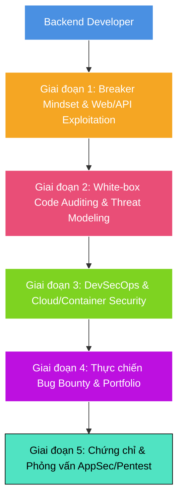

# Lộ Trình & Kế Hoạch Đào Tạo Toàn Diện: Dev Sang Security (AppSec / Pentest / DevSecOps)

> **Mục tiêu**: Chuyển đổi toàn diện từ Backend Developer thành **Application Security (AppSec) Engineer**, **Web/API Penetration Tester** hoặc **DevSecOps Engineer** trong vòng **6 – 9 tháng** (10 – 15 giờ/tuần).

---

## 1. Bản Đồ Tổng Quan (Architecture & Career Roadmap)

---

## 2. Kế Hoạch Đào Tạo Theo Từng Giai Đoạn

### Giai đoạn 1: Tư Duy Tấn Công (Breaker Mindset) & Web/API Exploitation
* **Thời lượng**: Tháng 1 – 2 (~8 tuần)
* **Mục tiêu**: Làm chủ Burp Suite, hiểu sâu OWASP Top 10 và các lỗ hổng tầng ứng dụng/API.
* **Thời gian học**: 12h/tuần (1.5h các ngày thường, 4.5h cuối tuần).

#### Tuần 1 – 2: Vũ khí hóa công cụ & Mạng nâng cao cho Security
- [x] Cài đặt & làm chủ **Burp Suite Community Edition** (Proxy, Repeater, Intruder, Decoder, Comparer).
- [x] Bắt gói tin HTTPS (cài CA Certificate vào Browser/Hệ điều hành qua Embedded Browser).
- [ ] Ôn lại tầng mạng chuyên sâu: TLS Handshake, CORS, CSP (Content Security Policy), SameSite Cookies, HSTS.
- [x] **Thực hành**:
  - Đọc và làm bài lab nhập môn tại [PortSwigger Web Security Academy](https://portswigger.net/web-security).

#### Tuần 3 – 5: "Tử huyệt" của Backend & API (OWASP Top 10)
- [x] **Access Control & BOLA (Broken Object Level Authorization)**: IDOR, phân quyền ngang (horizontal) và phân quyền dọc (vertical) *(Đã hoàn thành 6 Labs Apprentice & Practitioner)*.
- [x] **Authentication & Session Flaws**: JWT attacks (None algorithm, brute-force weak HMAC secret, key confusion), Session Fixation *(Đã hoàn thành 3 Labs JWT)*.
- [x] **Server-Side Request Forgery (SSRF)**: Khai thác Cloud metadata (`169.254.169.254`), tấn công microservices nội bộ *(Đã hoàn thành 3 Labs Apprentice & Practitioner)*.
- [ ] **Injection Flaws**: SQL Injection (Bypass ORM, Time-based blind SQLi), Command Injection, SSTI (Server-Side Template Injection).
- [ ] **Race Conditions & Concurrency**: Lỗi logic thanh toán, lạm dụng coupon bằng `Turbo Intruder`.
- [ ] **Thực hành**:
  - Hoàn thành tối thiểu **30 bài lab mức độ Apprentice & Practitioner** trên PortSwigger.

#### Tuần 6 – 8: Đánh sập API thực tế (Vulnerable API Labs)
- [ ] Dựng môi trường lab hoàn chỉnh trên máy: [OWASP crAPI](https://github.com/OWASP/crAPI) và [OWASP Juice Shop](https://owasp.org/www-project-juice-shop/).
- [ ] Thực hiện Black-box & Gray-box Pentest toàn bộ API của crAPI theo chuẩn **OWASP API Security Top 10**.
- [ ] Viết một bản báo cáo Pentest mẫu (Vulnerability Report) cho ít nhất 3 bug tìm thấy.

---

### Giai đoạn 2: White-box Auditing & Phân Tích Mã Nguồn (AppSec Core)
* **Thời lượng**: Tháng 3 – 4 (~8 tuần)
* **Mục tiêu**: Đọc hiểu source code tìm lỗ hổng, viết custom rules phát hiện bug tự động, mô hình hóa mối đe dọa.

#### Tuần 9 – 11: Kỹ thuật Source Code Review (Audit)
- [ ] Nắm vững mô hình phân tích dòng dữ liệu: **Source ➔ Sanitizer / Validator ➔ Sink**.
- [ ] Nhận diện các điểm chết (Dangerous Sinks) trong các ngôn ngữ:
  - *Node.js*: `eval()`, `child_process.exec()`, `vm.runInNewContext()`, prototype pollution.
  - *Java*: `Runtime.getRuntime().exec()`, `ObjectInputStream.readObject()`, JPA/Hibernate native queries.
  - *Python*: `pickle.loads()`, `yaml.load()`, `os.system()`, `render_template_string()`.
  - *Go / C#*: Unsafe reflection, Command execution, Raw SQL queries.
- [ ] **Thực hành**:
  - Giải các bài lab White-box trên [Damn Vulnerable Web Application (DVWA)](https://dvwa.co.uk/).

#### Tuần 12 – 14: Tự động hóa kiểm thử mã nguồn với SAST (Semgrep)
- [ ] Học cú pháp và viết Rule tùy chỉnh với **Semgrep**:
  - Bắt các câu query SQL ghép chuỗi.
  - Bắt các endpoint thiếu middleware xác thực / phân quyền.
  - Bắt hardcoded secrets (API keys, JWT secrets).
- [ ] Hoàn thành các khóa học tại [Semgrep Academy](https://academy.semgrep.dev/) (Miễn phí).

#### Tuần 15 – 16: Threat Modeling & Secure Architecture
- [ ] Áp dụng mô hình **STRIDE** vào kiến trúc microservices.
- [ ] Thực hành Threat Modeling cho một hệ thống E-commerce / Fintech mẫu:
  - Vẽ DFD (Data Flow Diagram).
  - Xác định ranh giới tin cậy (Trust Boundaries).
  - Đề xuất giải pháp khắc phục (Mitigations).

---

### Giai đoạn 3: DevSecOps & Bảo Mật Hạ Tầng / Cloud
* **Thời lượng**: Tháng 5 – 6 (~8 tuần)
* **Mục tiêu**: Đưa bảo mật vào chu trình CI/CD (Shift-Left), bảo mật Container và Cloud.

#### Tuần 17 – 19: Xây dựng Secure CI/CD Pipeline
- [ ] Tích hợp 4 lớp bảo mật vào GitHub Actions / GitLab CI:
  1. **Secret Scanning**: TruffleHog / Gitleaks (chặn commit lộ key).
  2. **SCA (Phụ thuộc bên thứ 3)**: Dependabot / Snyk / Trivy (tìm CVE trong package.json, pom.xml, requirements.txt).
  3. **SAST (Phân tích tĩnh)**: Semgrep / SonarQube.
  4. **DAST (Quét động)**: OWASP ZAP baseline scan.

#### Tuần 20 – 22: Container & Kubernetes Security
- [ ] Best practices bảo mật Dockerfile:
  - Chạy với Non-root user.
  - Sử dụng Distroless hoặc Minimal base image (Alpine).
  - Multi-stage build để loại bỏ build tools khỏi production.
- [ ] Quét lỗ hổng image với **Trivy**.
- [ ] Khái niệm bảo mật K8s: Network Policies, RBAC, Pod Security Standards, Secrets Management (HashiCorp Vault / AWS Secrets Manager).

#### Tuần 23 – 24: Cloud Security Fundamentals (AWS / GCP)
- [ ] IAM Principle of Least Privilege: Tách biệt Role, tránh gán quyền `*`.
- [ ] Bảo vệ API Gateway, CloudFront / WAF (Web Application Firewall) rules.
- [ ] Cấu hình bảo vệ AWS Metadata Service (IMDSv2) để chống SSRF.

---

### Giai đoạn 4: Thực Chiến, Săn Bug & Xây Dựng Profile
* **Thời lượng**: Tháng 7 – 8 (~8 tuần)
* **Mục tiêu**: Có chứng nhận, có write-up thực tế, có danh tiếng và cọ xát môi trường thật.

- [ ] **Săn Bug Bounty (HackerOne / Bugcrowd)**:
  - Chọn các chương trình VDP (Vulnerability Disclosure Program - không thưởng tiền nhưng cộng điểm reputation).
  - Tập trung vào mảng API & Business Logic flaws (sở trường của backend dev).
- [ ] **Tạo Blog cá nhân / Write-ups**:
  - Viết 3 – 5 bài phân tích sâu về: Lỗ hổng bạn từng fix, giải thích cơ chế của 1 CVE nổi tiếng, hoặc write-up bài lab PortSwigger khó.
- [ ] **Xây dựng GitHub Portfolio**:
  - Repository chứa các Custom Semgrep Rules bạn tự viết.
  - Demo một CI/CD pipeline chuẩn DevSecOps tích hợp đầy đủ tool security.

---

### Giai đoạn 5: Chứng Chỉ & Phỏng Vấn Tuyển Dụng
* **Thời lượng**: Tháng thứ 9

#### Chứng chỉ giá trị cao cho hướng AppSec / Pentest
1. **BSCP (Burp Suite Certified Practitioner)**: Chứng chỉ thực hành cực kỳ uy tín về Web Security từ chính PortSwigger, giá thi rẻ (~$99), giá trị thực chiến rất cao.
2. **eWPT / eJPT (INE Security)**: Chứng chỉ pentest web thực hành ở mức nhập môn – trung cấp.
3. **CKS (Certified Kubernetes Security Specialist)**: Nếu chọn đi sâu hướng DevSecOps / Cloud.

#### Chuẩn bị Phỏng vấn AppSec Engineer
- [ ] **Vòng 1: Kiến thức nền tảng Web & Lỗ hổng**: Giải thích chi tiết cơ chế hoạt động, điều kiện khai thác và cách vá triệt để của OWASP Top 10.
- [ ] **Vòng 2: Code Review phỏng vấn**: Nhà tuyển dụng đưa 1 đoạn code (Java/Node/Python), yêu cầu bạn chỉ ra 3 lỗ hổng bảo mật và viết lại code an toàn.
- [ ] **Vòng 3: System Design Security**: Thiết kế hệ thống Auth/SSO, xử lý thanh toán, hoặc kiến trúc API chống BOLA/Rate limiting.

---

## 3. Lịch Học Mẫu Mỗi Tuần (Dành Cho Người Đang Đi Làm)

| Ngày | Khung giờ | Nội dung công việc |
| :--- | :--- | :--- |
| **Thứ 2 - Thứ 4** | 20:30 - 22:00 | Đọc lý thuyết chuyên đề + Xem video phân tích CVE. |
| **Thứ 5 - Thứ 6** | 20:30 - 22:00 | Giải 1 – 2 bài Lab thực hành trên PortSwigger. |
| **Thứ 7** | 08:30 - 12:00 | Lab nặng (crAPI, dựng tool, viết rule Semgrep, audit code). |
| **Chủ Nhật** | Nghỉ / 1 tiếng | Tổng kết, ghi chú lại các lỗi mới vào Obsidian / Notion. |

---

## 4. Tài Liệu Bắt Buộc Phải Đọc

1. **Sách**:
   - *The Web Application Hacker's Handbook (WAHH)* – Kinh thánh của Web Pentest.
   - *Alice and Bob Learn Application Security* (Tanya Janca) – Sách AppSec nhập môn xuất sắc nhất cho Dev.
   - *Real-World Bug Hunting* (Peter Yaworski) – Học cách tư duy tìm lỗi từ các báo cáo bug thật.
2. **Cheat Sheet & Khóa học**:
   - [OWASP Cheat Sheet Series](https://cheatsheetseries.owasp.org/) (Bookmark ngay, chứa mọi best practice vá lỗi).
   - [PortSwigger Academy](https://portswigger.net/web-security).
   - [HackTricks Web](https://book.hacktricks.xyz/).

---

## 5. Phụ Lục Chuyên Sâu Cho 4 Tech Stack (Node.js, Java, Go, .NET)

> Bộ 4 ngôn ngữ này bao phủ hơn 90% backend doanh nghiệp. Dưới đây là các "tử huyệt" và Dangerous Sinks bạn cần thuộc nằm lòng khi Review Code & Pentest:

### 1. Node.js (Express / NestJS)
* **Lỗ hổng đặc trưng**:
  - **Prototype Pollution**: Xảy ra khi hàm recursive merge/clone object gán đè `__proto__` (như thư viện lodash cũ), dẫn tới DoS hoặc RCE.
  - **ReDoS (Regular Expression Denial of Service)**: Regex dạng catastrophic backtracking xử lý chuỗi đầu vào dài làm nghẽn single thread của Event Loop.
  - **Dangerous Sinks**: `child_process.exec()` (cho phép command injection, dùng `execFile` an toàn hơn), `eval()`, `vm.runInContext()`, `node-serialize`.
  - **ORM Injection**: Lỗ hổng NoSQL Injection trong Mongoose (`{"$ne": ""}`) hoặc bypass query parser.

### 2. Java (Spring Boot)
* **Lỗ hổng đặc trưng**:
  - **Insecure Deserialization**: Lỗ hổng kinh điển số 1 của Java (`readObject`, Jackson polymorphic typing với `enableDefaultTyping()`, Fastjson parser).
  - **SpEL (Spring Expression Language) Injection**: Tương tự như lỗ hổng Spring4Shell nổi tiếng, parse chuỗi biểu thức từ user input cho phép RCE trực tiếp: `parser.parseExpression(userInput).getValue()`.
  - **XXE (XML External Entity)**: Parse XML bằng `DocumentBuilderFactory` hoặc `SAXParser` mà chưa tắt tính năng nạp DTD ngoài.
  - **SQL Injection trong JPA/Hibernate**: Sử dụng `entityManager.createNativeQuery("SELECT ... " + input)` hoặc nối chuỗi HQL.

### 3. Go (Golang)
* **Lỗ hổng đặc trưng**:
  - **Race Condition / Concurrency Bugs**: Goroutines chia sẻ biến mà không có `sync.Mutex` hoặc Channel bảo vệ. Dùng cờ `go test -race` hoặc `go run -race` để audit.
  - **Command Injection**: Dùng `exec.Command("sh", "-c", userInput)` (thay vì truyền mảng argument cố định).
  - **Path Traversal**: Sử dụng `filepath.Join(baseDir, userInput)` nhưng không kiểm tra lại bằng `strings.HasPrefix(targetPath, baseDir)` sau khi `filepath.Clean()`.
  - **SSRF**: Gọi `http.Get(userUrl)` từ service Go mà không filter dải IP Private (`10.0.0.0/8`, `172.16.0.0/12`, `192.168.0.0/16`, `127.0.0.1`).

### 4. .NET (C# / ASP.NET Core)
* **Lỗ hổng đặc trưng**:
  - **Insecure Deserialization**: Dùng `BinaryFormatter` (đã bị Microsoft khuyến cáo cấm dùng), hoặc `Newtonsoft.Json` cấu hình `TypeNameHandling.All / Auto` cho phép hacker nạp arbitrary object gadget để RCE.
  - **Entity Framework Core SQLi**: Dùng `FromSqlRaw("SELECT * FROM Users WHERE Name = '" + name + "'")` (chuẩn an toàn là `FromSqlInterpolated` hoặc tham số hóa).
  - **Mass Assignment (Over-posting)**: Bind trực tiếp request body vào Database Entity Model mà không dùng ViewModel / DTO riêng.
  - **SSRF / Open Redirect**: Lạm dụng `HttpClient` hoặc `Redirect(returnUrl)` không validate domain đích.

---

## 6. Action Plan: Tuần 1 Của Bạn Bắt Đầu Ngay Hôm Nay

- [ ] **Bước 1 (30 phút)**: Tải và cài đặt [Burp Suite Community Edition](https://portswigger.net/burp/communitydownload).
- [ ] **Bước 2 (30 phút)**: Cấu hình Proxy của Burp Suite với trình duyệt (hoặc dùng ngay trình duyệt Embedded Chromium có sẵn trong Burp). Bắt thử vài request đăng nhập/xem API của một trang web bất kỳ.
- [ ] **Bước 3 (1 giờ)**: Tạo tài khoản tại [PortSwigger Academy](https://portswigger.net/web-security) và hoàn thành 3 bài lab đầu tiên của phần **Authentication** và **Access Control**.
- [ ] **Bước 4 (30 phút)**: Cài đặt Semgrep CLI trên máy (`pip install semgrep` hoặc `brew install semgrep`), thử chạy lệnh scan `semgrep scan --config auto` vào 1 repo backend (Node/Java/Go/.NET) cũ của chính bạn để xem kết quả.
